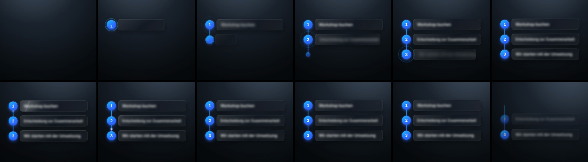

# Motion Graphic „3 Schritte“ – Overlay mit Alphakanal

3,5 Sekunden lang, mit transparentem Hintergrund, zum Drüberlegen auf das echte Video.
Drei nummerierte Schritte werden nacheinander aufgebaut. Die Schritt-Texte bleiben dabei bewusst geblurrt:

1. Workshop buchen
2. Entscheidung zur Zusammenarbeit
3. Wir starten mit der Umsetzung



## Dateien (`export/<format>/`)

| Datei | Wofür |
|---|---|
| `3-Schritte_<format>_ALPHA_ProRes4444.mov` | **Hauptdatei.** ProRes 4444 mit Alphakanal für Premiere Pro, After Effects, Final Cut und DaVinci Resolve: einfach auf eine Spur über das Video legen. |
| `3-Schritte_<format>_ALPHA.webm` | VP9 mit Alphakanal (Web/Browser, einige Online-Editoren) |
| `3-Schritte_<format>_SCHWARZ.mp4` | Fallback für Editoren ohne Alpha-Unterstützung (z. B. CapCut): auf schwarzem Hintergrund, Mischmodus **„Negativ multiplizieren“ / „Screen“**. Die dunklen Glasflächen fallen dabei weg; Ziffern, Linie und Text bleiben. |
| `3-Schritte_<format>_VORSCHAU.mp4` | Nur zur Ansicht über einem Demo-Hintergrund |
| `…_Text-scharf_…` | Alternative: Der Text blurrt ein und wird dann scharf (WebM mit Alpha + Vorschau; ProRes per `--prores-all`) |

Formate: `9x16` (1080×1920, Reels/TikTok/Stories), `4x5` (1080×1350, Feed), `1x1` (1080×1080), `16x9` (1920×1080).
Alle Dateien haben 30 fps, 105 Frames und 3,5 s. Erster und letzter Frame sind komplett transparent.

Im 9:16-Format sitzt der Block oberhalb der unteren UI-Zone von Reels und TikTok.
Da der Hintergrund transparent ist, lässt er sich im Schnitt frei verschieben und skalieren.

## Ablauf

| Zeit | Was passiert |
|---|---|
| 0,10 s / 0,48 s / 0,86 s | Badge 1, 2 und 3 poppen auf (mit leichtem Overshoot und Ring-Ping). Die Linie wächst jeweils genau bis zum nächsten Badge. |
| je +0,1 s | Die Glas-Karte wächst aus dem Badge, der Text blendet stark unscharf ein und bleibt auf leichtem Blur. |
| 1,6–2,3 s | Ein Lichtimpuls läuft durch die Linie, Badges glühen auf, ein Glanz läuft über jede Karte. |
| 2,9–3,45 s | Die Schritte blenden nacheinander nach oben weich aus (Blur-Out). |

## Anpassen und neu rendern

Alles liegt in `index.html`:

- **Brand:** die CSS-Variablen ganz oben (`--accent`, `--accent-2`, `--font`, Glas-Farben, `--card-radius`)
- **Texte, Blur-Stärke, Dauer:** `CONFIG` im Script
- **Position je Format:** `FORMATS[...].anchorY`

Live-Vorschau im Browser: `index.html` öffnen. Unten links lassen sich Format, Hintergrund und Variante umschalten.

```bash
npm install
npm run render                                   # alle Formate + beide Varianten
node render.mjs --formats 9x16 --fps 25          # nur 9:16, 25 fps
node render.mjs --prores-all                     # ProRes auch für die Text-scharf-Variante
```

Voraussetzungen: Node 18+, ffmpeg (mit `prores_ks` und `libvpx-vp9`).
Gerendert wird Frame für Frame mit Playwright/Chromium. Jedes Bild ist dadurch deterministisch, ohne Ruckler oder ausgelassene Frames.

> **Hinweis zum Stil:** www.gitis.de war aus der Render-Umgebung nicht erreichbar.
> Farben und Schrift (Blau-Verlauf, Inter) sind deshalb **Platzhalter** im Stil einer modernen Software-Marke.
> Mit den echten GITIS-Werten (Hex-Farben, Schrift) sind die Variablen in einer Minute getauscht und neu gerendert.
